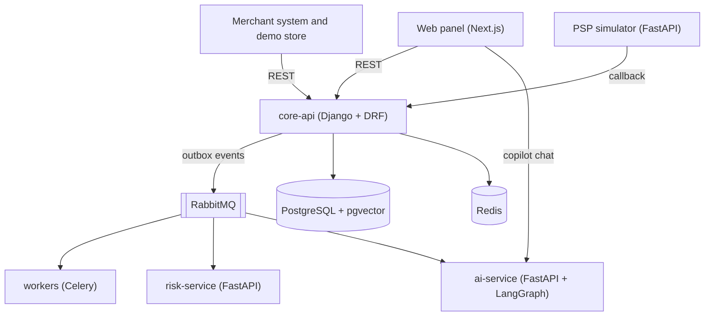
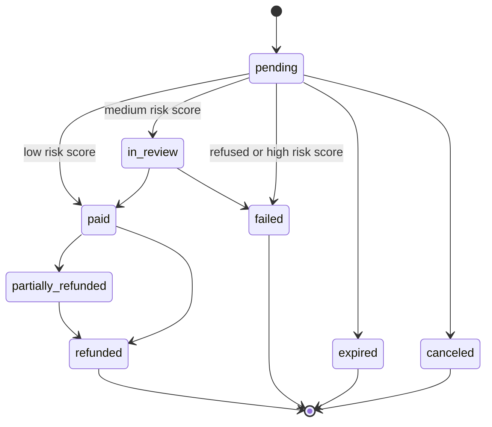
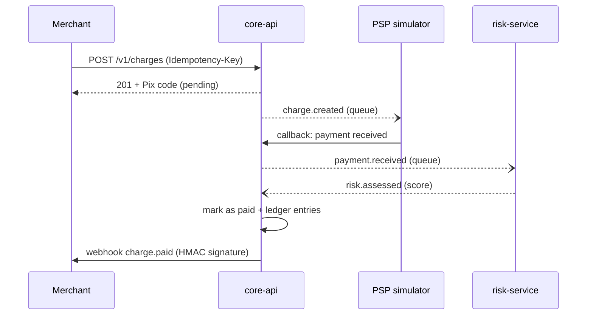

# PayLab

[](https://github.com/GuilhermeFonseca10/paylab/actions/workflows/ci.yml)


A sandbox payment gateway with a public REST API, an event-driven architecture and
an AI copilot for integrators.

> **Sandbox only.** PayLab is a learning project. It does not process real money,
> does not connect to real payment networks and is not a payment institution.

## Why this project

Integrating with payment providers is hard: confirmations are asynchronous,
notifications can arrive twice or out of order, and a network failure can lead to a
duplicate charge. PayLab explores how a platform solves these problems: idempotent
APIs, a double-entry ledger, reliable webhooks, and an AI copilot that helps
developers debug their integrations.

## Planned features

- Simulated Pix charges with copy-and-paste code and QR code
- Idempotent API (`Idempotency-Key`) with cursor pagination and OpenAPI docs
- Double-entry ledger with balances, statements and simulated settlement
- Full and partial refunds
- Signed webhooks (HMAC) with retries, dead-letter queue and manual resend
- Rule-based risk scoring with a manual review queue
- AI copilot (RAG + LangGraph) that explains errors and failed webhooks, with human
  approval for any action that changes state
- Web panel and a demo store that integrates through the public API

## Architecture



### Charge lifecycle



### Payment flow



## Tech stack

| Area | Technology |
|---|---|
| Core API | Python 3.12, Django, Django REST Framework |
| Satellite services | FastAPI, Pydantic |
| Messaging and tasks | RabbitMQ, Celery |
| Data | PostgreSQL 16 with pgvector, Redis |
| AI | LangChain, LangGraph, Ollama (local models), RAGAs, Langfuse |
| Front end | Next.js, TypeScript |
| Quality | pytest, Hypothesis, ruff, mypy, pre-commit |
| Infrastructure | Docker, Docker Compose, Kubernetes (kind), Terraform |
| CI/CD | GitHub Actions |
| Cloud (final phase) | AWS: ECS Fargate, RDS, SQS/SNS, S3 |

## Getting started

### Prerequisites

- Git
- Docker Desktop (with Compose v2)
- [Task](https://taskfile.dev) (`winget install Task.Task` on Windows)

### Run the local infrastructure

```bash
git clone https://github.com/GuilhermeFonseca10/paylab.git
cd paylab
cp .env.example .env    # then edit the passwords
task up                 # starts PostgreSQL, Redis and RabbitMQ and waits until healthy
task ps                 # shows the status of the services
```

RabbitMQ management UI: http://localhost:15672 (use the credentials from your `.env`).
Run `task` to list all available commands.

## Project structure

```text
paylab/
  apps/
    core-api/         Django + DRF
    psp-simulator/    FastAPI
    risk-service/     FastAPI
    ai-service/       FastAPI + LangGraph
    web/              Next.js
    demo-store/       Next.js
  infra/
    compose/ k8s/ terraform/
  docs/
    adr/              Architecture Decision Records
  .github/workflows/  CI
```

## Roadmap

| Phase | Goal | Status |
|---|---|---|
| 0 | Foundation: repository, docs, CI, local infrastructure | Done |
| 1 | Core and multi-tenancy | Next |
| 2 | Charges and idempotency | Planned |
| 3 | Ledger and balances | Planned |
| 4 | PSP simulator and events | Planned |
| 5 | Webhooks | Planned |
| 6 | Refunds and risk | Planned |
| 7 | Web panel and demo store | Planned |
| 8 | AI copilot | Planned |
| 9 | Observability and load tests | Planned |
| 10 | CI/CD and Kubernetes | Planned |
| 11 | Cloud deployment and polish | Planned |

## Documentation

- [Design document](docs/paylab-design-doc.md) (in Portuguese)
- [Architecture Decision Records](docs/adr/)
- [Contributing guide](CONTRIBUTING.md)
- [Changelog](CHANGELOG.md)

## License

[MIT](LICENSE)
